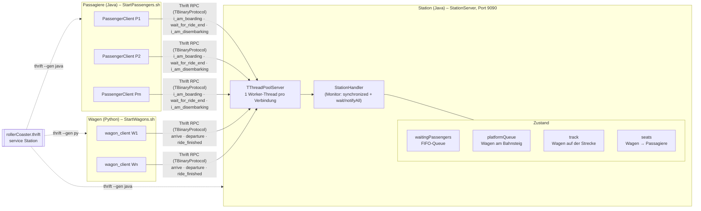
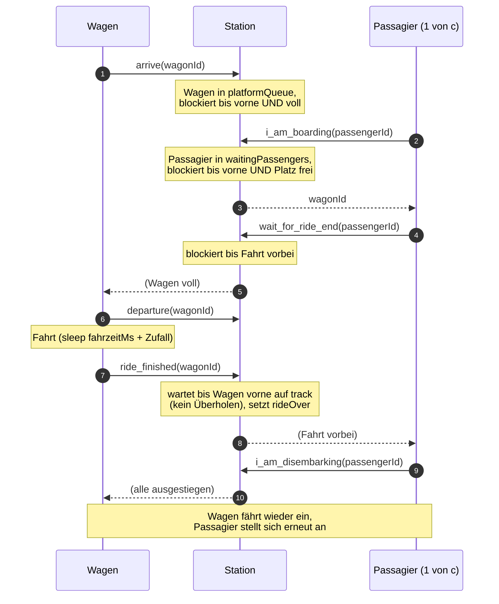

# Roller Coaster

Verteilte Achterbahn-Simulation mit Apache Thrift:

- **Station** (Java) – Server, koordiniert Wagen und Passagiere
- **Passagiere** (Java) – `rollerCoaster.PassengerClient`
- **Wagen** (Python) – `src/python/wagon_client.py`

## Architektur

### Komponenten



Alle Clients sprechen mit **einer** `StationHandler`-Instanz. Blockierende Calls (z. B. `i_am_boarding`, `arrive`) hängen serverseitig in `wait()`, bis ihre Bedingung erfüllt ist – der Client wartet einfach auf die RPC-Antwort.

### Ablauf einer Fahrt (Kapazität c)



## Projektstruktur

```
rollerCoaster.thrift      Schnittstellendefinition
src/rollerCoaster/        Java-Code (StationServer, StationHandler, PassengerClient)
src/python/               Python-Code (wagon_client.py)
gen-java/, gen-py/        von Thrift generierter Code (nicht von Hand bearbeiten)
build/                    kompilierte Java-Klassen
lib/                      Java-Abhängigkeiten (libthrift, slf4j)
logs/                     Logs der Wagen und Passagiere (nur nativer Betrieb)
Start*.sh                 Startskripte für den nativen Betrieb unter Arch Linux
Dockerfile, compose.yaml  Container-Build und VM-Seite (dort nur Clients)
docker/                   Generator und Warte-Skript für die Client-Container
compose.clients.yaml      generierte Client-Services (nicht eingecheckt)
.env.example, Makefile    Konfiguration und Kommandos für den verteilten Betrieb
```

## Voraussetzungen (Arch Linux)

- `jdk21-openjdk` – Java 21 (JDK zum Kompilieren und Starten der Station)
- `python` – Python 3 (mit `venv` für das native Setup; im Docker-Image kommt es automatisch mit)
- `thrift` – nur nötig, wenn `rollerCoaster.thrift` geändert wird (generierter Code liegt im Repo)

```shell
sudo pacman -S jdk21-openjdk python
# optional, nur bei IDL-Änderungen: sudo pacman -S thrift
```

## Setup

### Python-Umgebung
```shell
python3 -m venv .venv
.venv/bin/pip install -r requirements.txt
```

### Code generieren
```shell
thrift --gen java --gen py rollerCoaster.thrift
```

### Java kompilieren
```shell
javac -cp "lib/*" -d build src/rollerCoaster/*.java gen-java/rollerCoaster/*.java
```

## Starten

### Station (Terminal 1)
```shell
java -cp "build:lib/*" rollerCoaster.StationServer 4
```

### Wagen (Terminal 2)
```shell
./StartWagons.sh localhost 4
```
Nutzung: `./StartWagons.sh <stationHost> <anzahl> [fahrzeitMs]`

### Passagiere (Terminal 3)
```shell
./StartPassengers.sh localhost 10
```
Nutzung: `./StartPassengers.sh <stationHost> <anzahl>`

### Live-Logs (Terminal 3 oder 4)
```shell
tail -F logs/*.log
```

## Aufräumen

```shell
pkill -f rollerCoaster.PassengerClient; pkill -f wagon_client.py
rm -f logs/*.log
```

## Verteilter Betrieb mit Docker (Station auf Laptop, Clients in der VM)

Für die Präsentation läuft die Station auf dem Laptop, alle Wagen und Passagiere
als **jeweils eigener Container** in der VM. Beide Maschinen sind im selben
Tailnet; die Clients verbinden sich direkt über die Tailnet-IP des Laptops.

### Voraussetzungen

- Laptop: `jdk21-openjdk`, Tailscale, Port 9090 erreichbar
- VM: `docker`, `docker-compose` (Compose v2), `make`, Tailscale, optional `netcat` für den Reichbarkeitscheck
- Kein Thrift-Compiler nötig (generierter Code liegt im Repo)

```shell
# auf der VM
sudo pacman -S docker docker-compose make netcat
sudo systemctl enable --now docker.service
sudo usermod -aG docker "$USER"   # danach neu anmelden
```

### Konfiguration

```shell
cp .env.example .env
# STATION_HOST = Tailnet-IP des Laptops (100.x.y.z)
# WAGONS / PASSENGERS = Anzahl der Client-Container
# ID_OFFSET = Offset, falls mehrere VMs laufen
```

Erreichbarkeit vorab prüfen (in der VM): `nc -vz <tailnet-ip-des-laptops> 9090`.

### Starten und Stoppen

```shell
make up          # generiert compose.clients.yaml und startet alle Clients
make ps          # ein Container pro Client
make logs        # alle Logs (oder: docker compose logs -f wagon-2)
make down        # alle Client-Container stoppen und entfernen
```

`docker/generate-compose.sh` erzeugt `compose.clients.yaml` mit expliziten Services
`wagon-1 … wagon-n` und `passenger-1 … passenger-m`. Der Generator läuft bei
`make up` und `make down` automatisch. `--scale` wird bewusst nicht verwendet:
dabei bekämen alle Replikate dieselbe Client-ID.

Jeder Container wartet beim Start per `docker/wait-for-station.sh` auf die Station;
`restart: on-failure` fängt Verbindungsabbrüche ab. Die Client-Logs laufen nach
stdout statt in `logs/`. Die bisherigen Startskripte und Datei-Logs bleiben für
den nativen Betrieb unverändert.

### Metriken und Demo

Die Station gibt alle 10 Sekunden einen Snapshot aus, z. B.

```
[METRIC] c=4 waiting=3 platform=1 track=2 boardings=28 departures=7 rides=7
```

Die Wagen-Container loggen zusätzlich ihre Fahrten (`[W2] … Fahrten: 5`), die
Passagiere zählen bereits seit jeher. Damit lassen sich in der Demo gut zeigen:
FIFO-Warteschlange, blockierende RPCs, volle Wagen und das Verhindern von
Überholen auf der Strecke.

Nach den Metrik-Änderungen muss die Station auf dem Laptop neu kompiliert werden
(`javac -cp "lib/*" -d build src/rollerCoaster/*.java gen-java/rollerCoaster/*.java`,
siehe Setup).

### Alles lokal in einem Container-Set (optional)

```shell
# in .env: STATION_HOST=station
docker compose -f compose.yaml -f compose.clients.yaml --profile local up -d
docker compose -f compose.yaml -f compose.clients.yaml --profile local down
```

